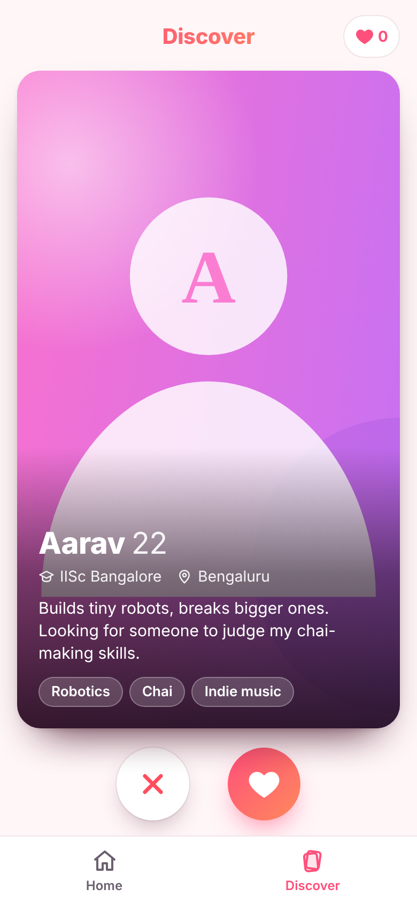
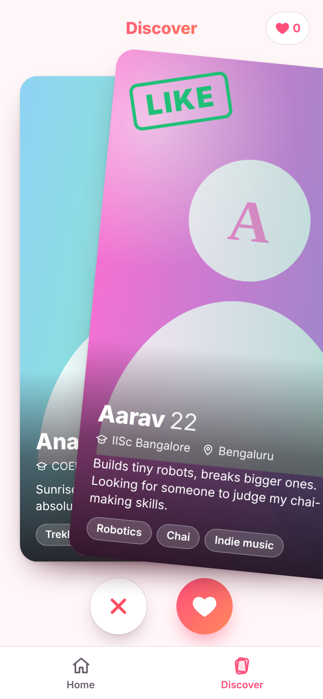
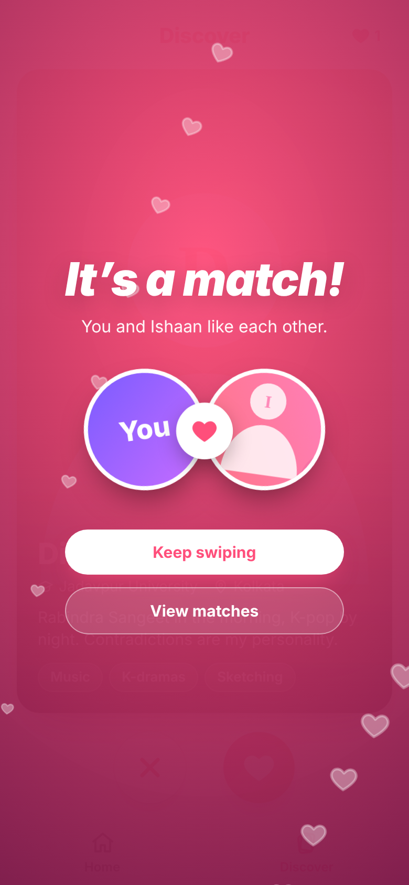
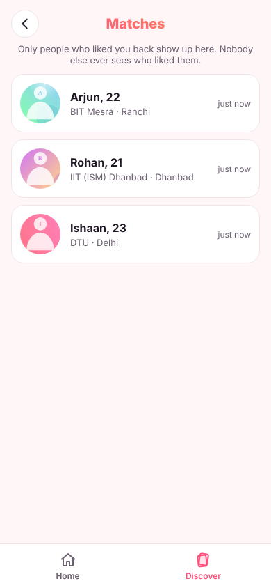

# Coy — Discover tab

A swipe-based **Discover** tab for [Coy](https://getcoy.com), built as a standalone mobile-first app for the Coy SDE Intern assignment.

- **Part A** (two feature suggestions): see [`PART_A.md`](./PART_A.md)
- **Part B** (this app): Next.js App Router + API routes, JSON-file persistence, `node:test` suite

| Swipe | Drag feedback | It's a match | Matches |
|---|---|---|---|
|  |  |  |  |

## Quick start

Requires Node.js 18.18+ (Node 20 or 22 recommended).

```bash
npm install
npm run dev          # http://localhost:3000 → opens the Discover tab
```

Production build:

```bash
npm run build && npm start
```

Other scripts:

| Command | What it does |
|---|---|
| `npm test` | Runs the backend + API test suite (Node's built-in test runner, no extra deps) |
| `npm run reset` | Clears all swipes and matches so the demo starts fresh |
| `npm run avatars` | Regenerates the placeholder profile photos in `public/avatars/` |

### Demo tips

- 32 seeded profiles; **8 of them have already liked you** (Ishaan, Rohan, Arjun, Riya, Nisha, Sneha, Anika, Myra), so liking them triggers **It's a match!**
- Mobile: drag the card left or right. Desktop: drag with the mouse, use the buttons, or press **←** / **→**.
- Reload at any point: swipes and matches persist in `data/db.json`.
- When you run out of profiles, the empty state has a **Start the demo over** link (calls `POST /reset`).

## Features

**Tabs.** A bottom tab bar with a blank **Home** placeholder (for Coy's existing experience) and **Discover**.

**Swipe experience**
- One card at a time, with the next cards stacked behind it. The next card scales up as the top one leaves.
- Pointer-event drag (touch, mouse and pen), with rotation that follows the finger. A swipe commits past ~28% of card width or on a fast flick; otherwise the card springs back.
- Live feedback while you drag: a **LIKE** or **NOPE** stamp and a colour tint fade in. The card then flies off with the stamp fully shown, and the pressed button reacts.
- Like/Pass buttons and keyboard shortcuts on desktop. Screen readers hear "Liked Aisha" or "Passed on Aisha" via an `aria-live` region.
- Optimistic UI: the card animates immediately and the swipe saves in the background. If the save fails, the card returns to the top with a toast, so a swipe is never silently lost.
- A swiped profile never comes back. The server excludes it from `/feed`, and the client removes it.
- Clear empty, loading (skeleton) and error (retry) states.

**Matching**
- A match is created only when you like someone who already liked you. The **It's a match!** screen appears at that moment.
- The **Matches** view (heart button, top right) lists mutual matches, newest first.

## API

All endpoints return JSON with `Cache-Control: no-store`. Errors use `{ "error": { "code", "message" } }`.

### `GET /feed`
Profiles the user hasn't swiped on yet. Optional `?limit=1..100`.
```json
{ "profiles": [ { "id": "p01", "name": "Aarav", "age": 22, "photo": "/avatars/p01.svg",
                  "bio": "…", "city": "Bengaluru", "college": "IISc Bangalore",
                  "interests": ["Robotics", "Chai", "Indie music"] } ] }
```

### `POST /swipe`
```json
{ "profileId": "p03", "action": "like" }      // action: "like" | "pass"
```
```json
{ "matched": false }
{ "matched": true, "match": { "profile": { … }, "matchedAt": "2026-11-20T10:00:00.000Z" } }
```
| Status | Code | When |
|---|---|---|
| 400 | `INVALID_JSON` / `INVALID_ACTION` / `INVALID_PROFILE_ID` | Bad request body |
| 404 | `PROFILE_NOT_FOUND` | Unknown profile |
| 409 | `ALREADY_SWIPED` | Trying to change an earlier swipe |

Repeating the **same** swipe is idempotent: it returns the original result, so network retries are safe.

### `GET /matches`
```json
{ "matches": [ { "profile": { … }, "matchedAt": "…" } ] }
```

### `POST /reset`
Demo helper. Clears all swipes and matches.

## Privacy: "never reveal who liked you"

This is Coy's core promise, so the backend enforces it rather than leaving it to the UI:

1. **Allow-listed output.** Every profile leaves the server through `toPublicProfile()` (`lib/publicProfile.js`), which copies only listed public fields. The private `likesYou` flag, and any private field added later, is excluded by default.
2. **No ordering leak.** The feed is in a fixed order that does not depend on who liked you. Boosting likers to the top is a common engagement trick, but here it would let a user work out who liked them from card position. A test checks this.
3. **A pass reveals nothing.** Passing on someone who liked you returns byte-for-byte the same response as passing on anyone else. Tests compare the raw response bodies.
4. **Swipes are final.** This mirrors Coy's own "adding is final" rule. Without it, a user could pass and then re-like everyone to probe who likes them. Changing a swipe returns `409`; repeating the same swipe is idempotent.
5. **No counts.** There is no "N people liked you" badge or endpoint. The only number shown is your mutual match count, which you already know.
6. A test sends every endpoint through a full session and asserts that `likesYou` never appears in any response.

## How it's built

```
app/
  layout.js            App shell + bottom tab bar
  page.js              Redirects / → /discover
  home/page.js         Blank Home placeholder
  discover/page.js     Discover tab
  feed/route.js        GET  /feed
  swipe/route.js       POST /swipe
  matches/route.js     GET  /matches
  reset/route.js       POST /reset (demo helper)
  globals.css          All styles (mobile-first; framed phone column on desktop)
components/
  Discover.js          Feed state, optimistic swipes, keyboard shortcuts, views
  SwipeCard.js         Drag gesture + animations for one card
  MatchModal.js        "It's a match!" screen
  MatchesView.js       Mutual matches list
  TabBar.js, Photo.js, Icons.js, api.js
lib/
  seed.js              32 mock profiles (likesYou is server-only)
  publicProfile.js     Allow-list serializer
  discover.js          Business logic: feed, swipe, matches
  db.js                JSON-file store: atomic writes + in-process lock
  http.js              JSON responses + error mapping
tests/                 node:test suites for logic and route handlers
scripts/               reset + avatar generator
```

**Persistence.** Profiles are static seed data. Only the user's own state (swipes and matches) is written to `data/db.json`, which is created on first write. Writes are serialised through an in-process lock and written atomically (temp file + rename), so rapid swipes can't overwrite each other and a crash can't leave a half-written file. If the file gets corrupted, it is set aside and the app starts clean. The location can be overridden with `COY_DATA_FILE`.

**Why a JSON file and not SQLite?** The assignment allows either. A JSON file needs no native module, so `npm install` works on any OS. The store sits behind `lib/db.js`, so switching to SQLite or Postgres only means changing that one file.

**Deploying (optional).** It runs on Vercel unchanged. On Vercel the store moves to `/tmp`, which is per-instance and temporary there, so state can reset between cold starts. For durable hosted state, point `lib/db.js` at a real database.

## Tests

```bash
npm test
```

24 tests across `tests/store.test.js` (business logic and persistence) and `tests/api.test.js` (the real route handlers, called with Web `Request` objects). They cover:

- Seed requirements
- Matching rules
- Swiped profiles never returning
- Validation and error codes
- Idempotency and the 409 rule
- Persistence to disk
- 30+ concurrent swipes with no lost writes
- Corrupt-file recovery
- The privacy guarantees listed above

## With more time

- Real auth, so the "has this person liked me" lookup becomes a proper `likes(from, to)` table queried at swipe time
- Card detail view (tap to expand) and more photos per profile
- Undo for the last *pass* only, with a short window. This would need care so it doesn't reopen the probing hole described above.
- Playwright end-to-end tests in CI
